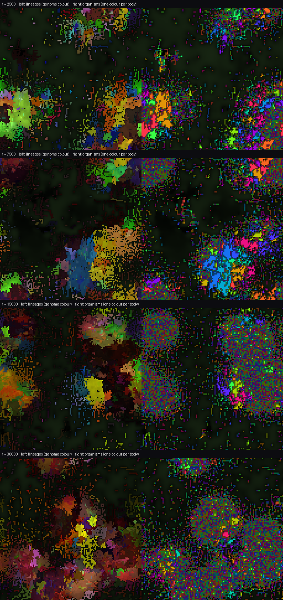

# Emergence

**A GPU world where genomes are token sequences, a transformer reads them, and the
cells it builds live, eat, share, steal, signal, divide, die and evolve on a large
grid. Nothing about organisms, bodies or behaviour is written in. The question is only:
what grows?**

```
 genome tokens  ──►  TRANSLATOR (fixed transformer)  ──►  phenotype
 "08 18 18 09 …"      reads the genome + a STATE token      gains & biases for
        ▲             (how the lineage is doing now)        every cell of that lineage
        │                         ▲                                │
        │ mutation at birth       │ lineage state fed back         ▼
        │ (point, insertion,      │ every 25 steps          CELL NETWORK (shared, fixed)
        │  deletion, duplication) │                         perceives → acts, every step
        │                         │                                │
        └──────── births ◄────────┴──── WORLD (torch, GPU) ◄───────┘
                                   food under moving suns, diffusing signals,
                                   energy that is conserved except where it is spent
```

Your morning idea, in the form it takes here: **tokens are genes, the transformer is
the ribosome, the grid is the body, and the body's state goes back into how the genes
are read.** The transformer never trains. Its weights are fixed when the world is born,
like a genetic code: one reading machinery for every lineage. What changes is the text.
Evolution is the only learner.



## Run it

```
pip install -r requirements.txt     # torch with CUDA for your GPU if not already installed
python run.py                       # live viewer, 384 x 384, picks up the GPU automatically
python run.py --size 512            # bigger world
python run.py --headless --steps 1000000 --out runs/night1 --video     # overnight
python run.py --load runs/night1/ckpt_1000000.pt                      # open it in the viewer
python plot.py runs/night1          # metrics.png
python inspect_world.py runs/night1/ckpt_1000000.pt    # who is alive and what their genomes say
```

Viewer: `1`–`8` switch views (life, bodies, clades, food, signals, state, energy, age);
`SPACE` pause; `+`/`-` steps per frame; **left drag wipes cells** (damage the
organisms and watch whether anything repairs); `F` then left drag pours food; right click
a cell to see its genome; `R` drops 500 fresh random cells (abiogenesis); `S` saves,
`P` screenshots, `V` records video.

Every law of the world is a field in [`emergence/config.py`](emergence/config.py) and
can be changed from the command line, e.g. `--set regulation=0 --set attack_rate=0.25`.

## What is in the world

**A cell** is one occupied grid site. Each step it perceives its 8 private state
channels, its energy and age, the food under it and its gradient, 4 diffusing chemical
signals and their gradients, the mean state of its neighbours, and how many neighbours
are body-mates, strangers, strangers with the same genome, or empty (38 inputs). One
shared network (38 → 48 → 21, fixed random weights) maps this to its actions. The
lineage's phenotype multiplies and shifts the 48 hidden units and biases the 21 outputs.
So two lineages run the same "physics of a cell" but read the situation differently.

**Actions:** update its private state; emit 4 signals; eat; share energy with
body-mates; steal energy from strangers; divide (and in which direction); and, at a
birth, whether the child **stays attached** to the parent's body or leaves.

**A body** is the set of cells descended from one founder through births that stayed
attached. Sharing works only inside a body. Whether births stay attached is the
genome's decision, so multicellular organisms are not defined into the world. They
exist only if lineages that hold together do better. A mutation inside a body does not
cut it apart (a somatic mutation: the body becomes a mosaic).

**Energy** enters only as food, which regrows fast under 7 slowly drifting "suns" and
slowly elsewhere. Eating moves food into a cell; sharing moves energy exactly between
body-mates; stealing moves it between strangers and loses 30%; living, signalling and
attacking cost energy; a dying cell returns 60% of what it holds to the food under it.
Old cells die more often (a hazard that rises after age 300).

**Genomes** are up to 48 tokens from a 32-letter alphabet, kept in a table on the GPU.
3% of births carry a mutation: a point change (60%), an insertion (15%), a deletion (15%)
or a tandem duplication of 2–6 tokens (10%). Each genome row records its founding clade,
its mutation depth, its parent row and its birth step, so ancestry can be read back
(`inspect_world.py`).

**The translator** is a 3-layer transformer (d = 96). It reads `[STATE] tok_1 … tok_n`
and outputs the phenotype. The STATE token is the lineage's lived condition: mean
private state of its cells, energy, the food under them, how surrounded by body-mates
they are, and how many cells it has. It is recomputed every 25 steps. That is the
feedback loop: what a lineage is going through changes how its genome is read.
`--set regulation=0` cuts the loop, which is the control for any claim that it matters.
Outputs are standardised over random genomes once at the start, so that a random
transformer gives phenotypes that really differ from genome to genome.

## What one small CPU run showed

I could not use a GPU here, so this is one run at 128 × 128 for 30,000 steps on two CPU
cores, seed 0. Treat it as observation, not result. ([metrics](docs/cpu_run_128_metrics.png))

- **Selection is strong and immediate.** 1,500 random founders → 476 lineages by step
  1,000, 26 by 10,000, 6 by 30,000. Diversity first collapses and then **rebuilds inside
  the winning lineages**: distinct genomes alive fall from ~780 to ~465 by step 5,000,
  then climb to ~860 as the survivors' descendants diversify.
- **Multicellularity appeared and then was lost.** The size of the organism a random
  cell lives in rose from 15 to 57 cells by step 8,000, with bodies of up to ~380 cells.
  Then it collapsed to 2–4 cells by step 25,000. At step 10,000 the multicellular
  genomes in the top list hold together (detach bias −0.9 to −1.3), and one of them
  is a predator (attack +1.37). The lineage that took over (clade 712) is the opposite:
  single cells or pairs that eat hard, share and **do not attack** (attack bias between
  −0.6 and −1.4 in all eight top genomes at step 30,000). In this world as written, peaceful grazing
  single cells beat the early bodies.
- **Life follows the suns.** Because food off the suns regrows slower than a cell burns
  energy, populations live on the moving oases and graze fronts into the food that
  piles up behind them.
- **Genomes grow, but that is not emergence.** Length rose from 16 to 18.5 tokens. The
  mutation operators add about 0.4 tokens per mutation on average, and the mean lineage
  carries 5.7 mutations. That predicts about +2.3 against +2.5 observed, so this growth is
  mutational bias, not selection. The repeated `29 18 17` blocks visible in the winners are
  tandem duplications, the operator at work, not evidence of function.

The interesting run is the one your GPU can do: 384² or 512² for a million steps. The
CPU run reached a mean of 5.7 mutations per lineage at about 30 steps per second. I
expect a few hundred steps per second on an RTX 3060, but I have not measured it.

## What to look for, and how to know it is real

The emergence video's lessons apply directly: watch with **continuous** measures (a
threshold can make a slope look like a jump), and when you think something is there,
**intervene** and see whether behaviour changes.

| question | how to ask it here |
|---|---|
| Do organisms come back, and stay? | `body_size_cellweighted` and `multicell_fraction` over a long run |
| Is multicellularity *functional*? | rerun with `--set share_rate=0`: if bodies are as large without sharing, they are just clonal patches |
| Does gene regulation matter? | same seed with `--set regulation=0`; compare `plot.py runs/a runs/b` |
| Is evolution doing the work, or just the founders? | `--set mutation_rate=0` (selection among founders only) |
| Is predation shaping bodies? | `--set attack_rate=0` and `--set attack_rate=0.3` |
| Repair | wipe a hole through a large organism in the viewer; does the same body regrow it, or do strangers take the space? |
| Signalling | the signals view: do lineages emit in patterns that line up with bodies or fronts? |
| Movement | bodies cannot move, only grow and die. Do any lineages "glide" after the suns? |

`plot.py` overlays several runs, so each control is one extra command.

## Prior work (fences, not novelty claims)

Growing neural cellular automata (Mordvintsev et al., 2020); HyperNCA, which grows a
network's weights with an NCA (Najarro et al., 2022); Lenia and Flow-Lenia; the Tierra
and Avida digital-evolution lineage; ALIEN (GPU artificial life); Sakana's Petri Dish
NCA and Digital Ecosystems, where several NCAs compete on one grid and learn during the
simulation; and population-based training of Petri Dish NCA
([arXiv 2604.11248](https://arxiv.org/pdf/2604.11248)). What this repo puts together is
token genomes inherited per cell with insertion/deletion/duplication, a fixed transformer
as the genotype-to-phenotype map, a lineage-state token that feeds back into expression,
and bodies that exist only through inherited attach/detach decisions. Whether that
combination has been done before is a literature question I have not settled.

## Not claimed

- That anything here is alive, or that the observations above replicate on other seeds.
- That the transformer "understands" genomes. It is a fixed random map; evolution
  finds the texts that map to good phenotypes.
- That regulation matters. The control (`regulation=0`) has not been run.
- That the GPU speed is known. The code is device-agnostic and was tested on CPU only.

## Files

```
emergence/config.py       every law of the world
emergence/genome.py       token genomes on the GPU, mutation, ancestry bookkeeping
emergence/translator.py   the transformer that turns genomes into phenotypes
emergence/world.py        the grid, the cell network, physics, bodies, metrics, save/load
emergence/render.py       views as images
run.py                    viewer and headless runner
plot.py                   metric plots, several runs overlaid
inspect_world.py          top genomes, their bodies and biases, ancestry chains
```
